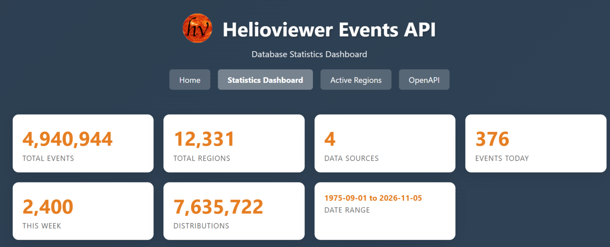
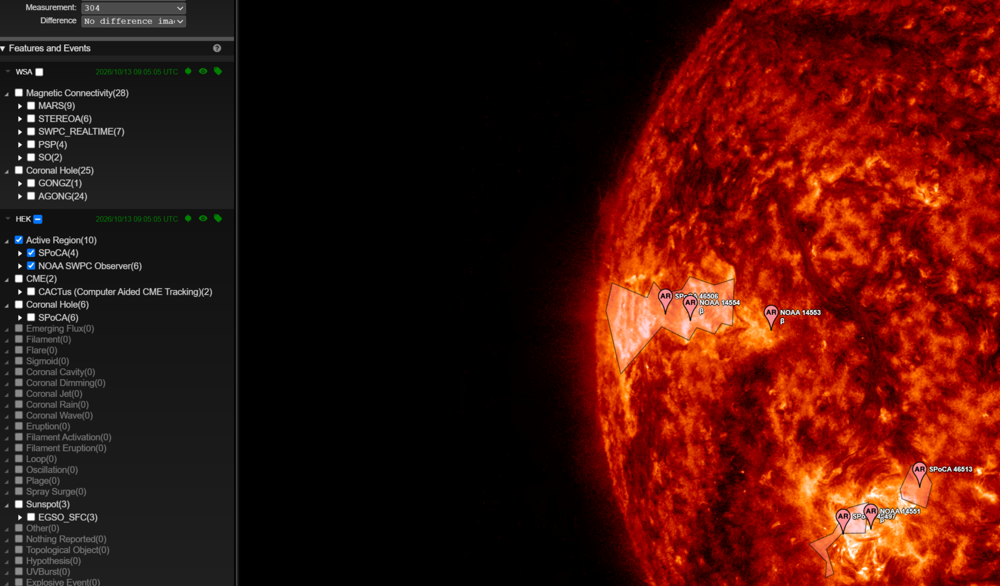

The Helioviewer Events API is now open for public use, and it is the
source of all solar events you see on
[helioviewer.org](https://helioviewer.org). Solar event catalogues come from many places, and each one has its own
format, its own coordinates and its own way of naming things. The Events
API collects them, puts them into one event model, and serves them
through one REST API.

Today it serves events from:

- [HEK](https://www.lmsal.com/hek/), the Heliophysics Event Knowledgebase:
  all event types
- [CCMC DONKI](https://ccmc.gsfc.nasa.gov/tools/DONKI/): solar flares and
  coronal mass ejections
- [CCMC Flare Scoreboard](https://ccmc.gsfc.nasa.gov/scoreboards/flare/):
  flare predictions from the scoreboard models
- [WSA](https://ccmc.gsfc.nasa.gov/wsa-dashboard/): coronal-hole maps and
  magnetic-connectivity footpoints
- [RHESSI](https://hesperia.gsfc.nasa.gov/rhessi3/): the RHESSI flare list

The API is live at
[https://events.helioviewer.org](https://events.helioviewer.org).

It holds almost 5 million events, going back to 1975.

{: style="max-width: 100%"}

## Features

- One event model for every source: the same fields for a HEK flare, a
  DONKI CME or a WSA coronal hole.
- Positions served in helioprojective arcseconds, rotated to the
  observation time you ask for.
- Event regions (footprints) as lists of polygons, so an event with many
  contours, like a coronal-hole map, comes as one event.
- Events behind the Sun are flagged, not dropped. Your client decides how
  to draw them.
- The original record from the provider is available for every event.
- Events are linked to NOAA and HARP active regions, and you can list all
  events of one region.
- Kept up to date: the current day is collected again every few minutes.
- Open source, Apache 2.0 license.

## Open for public use

- OpenAPI / Swagger UI:
  [https://events.helioviewer.org/api-docs](https://events.helioviewer.org/api-docs)
- OpenAPI spec:
  [https://events.helioviewer.org/openapi.json](https://events.helioviewer.org/openapi.json)

For example, all HEK events active at one moment:

```python
import requests

url = "https://events.helioviewer.org/api/v1/events/HEK/observation"
events = requests.get(f"{url}/2025-03-15T12:00:00Z").json()
```

Other public endpoints give a single event by id, its original source
record, the latest updated events, and the active regions with their
events. There is also an
[active regions search page](https://events.helioviewer.org/active-regions).

## Integrated into helioviewer.org

helioviewer.org now gets all of its features and events from the Events
API. In the viewer, open _Data Sources > Features and Events_ and pick
any source: HEK, CCMC, WSA or RHESSI.

- The events tree in that panel is the event-tree React component
  described below.
- Event regions are drawn from the API footprints, also when an event has
  many contours.
- Event markers and regions follow the time you are looking at, because
  the API rotates positions to that time.
- Events you select also go into your screenshots and movies.
- Clicking a marker opens the event details, with a link to the event's
  JSON in the Events API.

{: style="max-width: 100%"}

## The event-tree React component

The events tree you see in helioviewer.org is a small React component,
and it is also open for public use. With it you can bring solar event
listings into your own React project: it loads the events for a date,
groups them in a tree, and lets users select them with checkboxes. Your
app gets the selected events back through a callback.

```bash
npm install @helioviewer/event-tree
```

```jsx
import HelioviewerEventTree from '@helioviewer/event-tree';

<HelioviewerEventTree
  source="HEK"
  eventsDate={new Date()}
  onEventsUpdate={(events) => console.log(events)}
  onHoveredEventsUpdate={(ids) => console.log(ids)}
/>
```

- Demo:
  [https://helioviewer-project.github.io/event-tree/](https://helioviewer-project.github.io/event-tree/)
- npm:
  [@helioviewer/event-tree](https://www.npmjs.com/package/@helioviewer/event-tree)
- Source:
  [github.com/Helioviewer-Project/event-tree](https://github.com/Helioviewer-Project/event-tree)

## Links

- Events API: [https://events.helioviewer.org](https://events.helioviewer.org)
- API reference (OpenAPI):
  [https://events.helioviewer.org/api-docs](https://events.helioviewer.org/api-docs)
- Events API source code:
  [github.com/Helioviewer-Project/events-api](https://github.com/Helioviewer-Project/events-api)
- event-tree component:
  [github.com/Helioviewer-Project/event-tree](https://github.com/Helioviewer-Project/event-tree)

If you have questions or find a problem, please
[send us an email](mailto:HelioviewerDevelopment@nasa.onmicrosoft.com) or
[file an issue](https://github.com/Helioviewer-Project/events-api/issues)
on the Events API project page.
