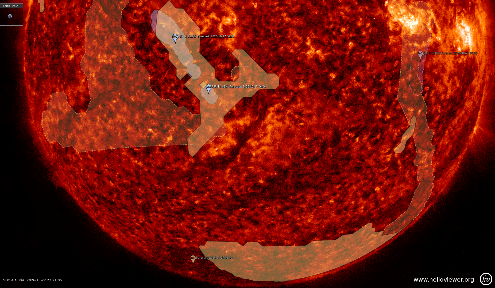
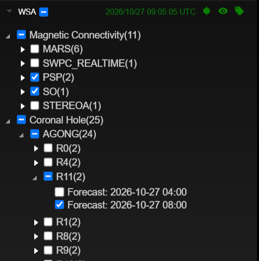
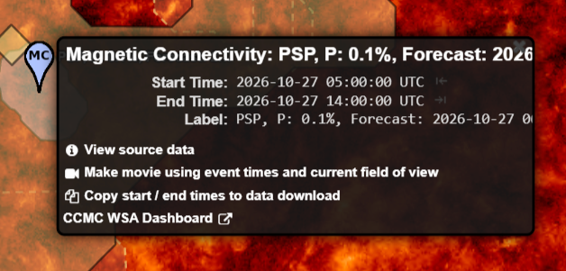
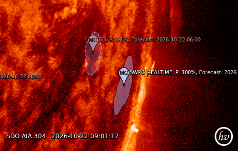
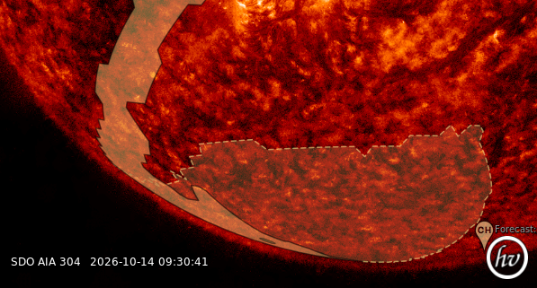

Coronal-hole maps and magnetic-connectivity footpoints from the WSA model
are now available on [helioviewer.org](https://helioviewer.org). WSA, the [Wang-Sheeley-Arge model](https://ccmc.gsfc.nasa.gov/models/WSA~5.4/),
is a model of the solar corona and the solar wind. It starts from maps of
the magnetic field on the surface of the Sun and works out how that field
opens into space. The [Community Coordinated Modeling Center](https://ccmc.gsfc.nasa.gov/)
(CCMC) runs WSA and publishes its results on the
[WSA dashboard](https://ccmc.gsfc.nasa.gov/wsa-dashboard/). Helioviewer
now brings two of these results onto the solar images.

**Coronal holes.** These are regions where the Sun's magnetic field is
open to space instead of looping back to the surface. They look dark in
extreme ultraviolet and X-ray images, and fast solar wind streams out of
them. WSA predicts where the coronal holes are. Each prediction is one
event in Helioviewer, and it holds all the hole outlines of that forecast.

**Magnetic connectivity footpoints.** The solar wind carries the Sun's
magnetic field out to the planets and spacecraft. The footpoint is the
place on the Sun where the field line reaching a given spacecraft starts,
so it shows where the solar wind arriving there most likely came from.
WSA gives this as probability contours: the inner contours are the most
likely origin.

<!-- SCREENSHOT: helioviewer.org, AIA 193 layer, one date with clear
     coronal holes. Turn on WSA > Coronal Hole > AGONG > R0 and one or two
     WSA > Magnetic Connectivity targets (e.g. PSP, SO), labels on, the
     Features and Events panel open on the WSA tree. The WSA outlines
     should sit over the dark coronal holes in the image. -->
{: style="max-width: 100%"}

## Where to find it

Open _Data Sources > Features and Events > WSA_. There are two branches:

{: style="float: left; width: 40%; max-width: 40%; margin: 0 1.5em 1em 0"}

**Coronal Hole:** _AGONG_, with one entry per realization (_R0_ to
_R11_), and _GONGZ_. These are the input magnetic maps WSA was run
with. AGONG is an ensemble of 12 realizations, so you can look at one
realization at a time.

**Magnetic Connectivity:** one entry per target, ACE, SWPC_REALTIME,
PSP (Parker Solar Probe), SO (Solar Orbiter), STEREOA and MARS.

{: style="float: left; width: 40%; max-width: 40%; margin: 0 1.5em 1em 0"}

Click any WSA marker to see the forecast time, the forecast window and,
for footpoints, the connectivity probability, with links back to the WSA
dashboard.

## Movies and screenshots

WSA events work like every other event in Helioviewer: you can put them
into screenshots and movies. Here is a movie made on helioviewer.org:

<!-- VIDEO: a helioviewer.org movie, AIA 193, a few
     days long, with WSA coronal holes (one AGONG realization) and a few
     magnetic connectivity targets on, so the regions are seen rotating
     with the Sun and crossing the limb. -->
<video controls="controls" preload="metadata" style="width: 100%">
  <source src="/images/uploads/2026/wsa_movie.mp4#t=0.1" type="video/mp4" />
</video>

(<a href="/images/uploads/2026/wsa_movie.mp4" download>download the video</a>)

## New event capabilities on helioviewer.org

WSA coronal holes, magnetic connectivity footpoints and their probability
regions can sometimes be behind the Sun as seen from Earth. To handle
this, helioviewer.org now shows events and regions on the far side in a
different style, so you can always tell what is in front of the Sun and
what is behind it.

### Events behind the Sun

{: style="float: left; width: 50%; max-width: 50%; margin: 0 1.5em 1em 0"}

As the Sun rotates, an event can move behind the limb. It does not
disappear: its marker and label are drawn faded, and you can still
click it to see its details.

The image shows two WSA magnetic connectivity footpoints. One is on the
near side of the Sun and is drawn as usual. The other is behind the Sun,
so its marker and label are faded.

### Near-side and far-side regions

{: style="float: left; width: 50%; max-width: 50%; margin: 0 1.5em 1em 0"}

Regions are drawn by which side of the Sun they are on:

- Near side: filled, as before.
- Far side: a dashed outline with a light tint.
- Crossing the limb: cut at the limb into the two.
{: style="list-style-position: inside; padding-left: 0"}

The image shows a WSA polar coronal hole stretching over the south pole.
The part on the near side, along the east limb, is filled. The part
that reaches over the pole onto the far side is drawn with a dashed
outline. It still projects onto the disk, but the dashed outline shows
it is behind the Sun.

## Links

- CCMC WSA dashboard:
  [https://ccmc.gsfc.nasa.gov/wsa-dashboard/](https://ccmc.gsfc.nasa.gov/wsa-dashboard/)
- WSA dashboard on CCMC Community Tools:
  [https://ccmc.gsfc.nasa.gov/community-tools/WSA-Dashboard/](https://ccmc.gsfc.nasa.gov/community-tools/WSA-Dashboard/)
- WSA model at CCMC:
  [https://ccmc.gsfc.nasa.gov/models/WSA~5.4/](https://ccmc.gsfc.nasa.gov/models/WSA~5.4/)
- WSA events in the Events API:
  [https://events.helioviewer.org/api/v1/events/WSA/observation/2026-10-15T12:00:00Z](https://events.helioviewer.org/api/v1/events/WSA/observation/2026-10-15T12:00:00Z)
- Events API reference (OpenAPI):
  [https://events.helioviewer.org/api-docs](https://events.helioviewer.org/api-docs)

Many thanks to the WSA team at CCMC for making these predictions
available and for their help.

If you have questions or comments about WSA in Helioviewer, please
[send us an email](mailto:HelioviewerDevelopment@nasa.onmicrosoft.com) or
[file an issue on the helioviewer.org project page](https://github.com/Helioviewer-Project/helioviewer.org/issues).
